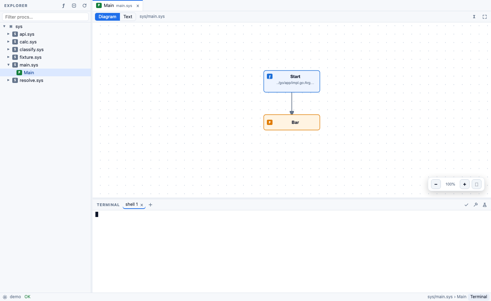
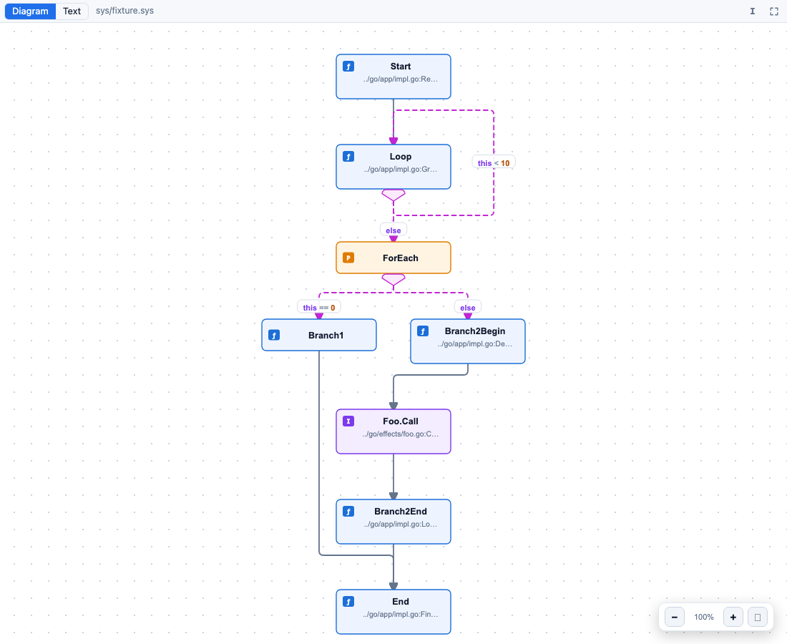
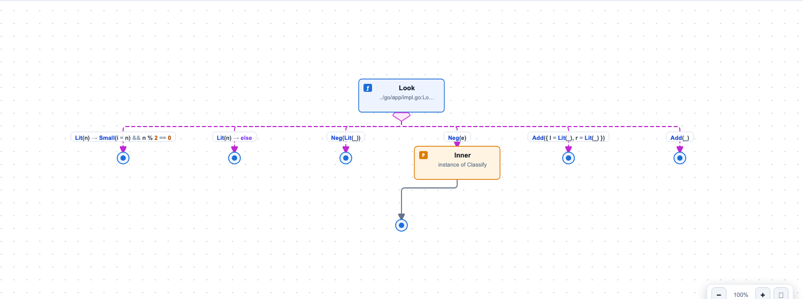
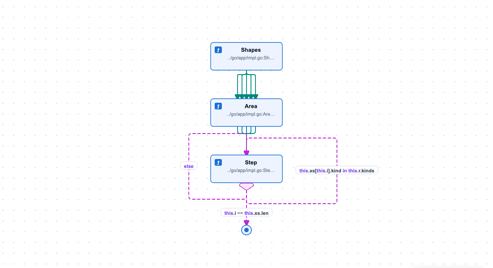

# vandorf

vandorf is a language for a program's control flow. A program is a set of
**procs**, each a graph: its nodes are **funcs**, implemented in Go or Rust,
and its edges say what runs next and with what. The compiler checks the graph
(types, every read sees a node that ran, switches cover every case) and
generates the control flow as code for both languages, together with a
diagram of every proc.

What it's for:

- **Control flow you can see.** The graph is the source, so the diagram
  can't drift from the code: loops, switches, for-each regions and
  concurrent branches are drawn as they run.
- **Implementations stay ordinary code.** Funcs are plain Go and Rust
  functions with generated signatures and types; the compiler writes the
  state machines that call them, so your code stays small, pure and
  testable. A func's declaration, with its doc comment, is the spec of its
  implementation, and `vcc build` checks each one against it.
- **One program, two backends.** The same `.sys` builds a Go package and a
  Rust module with the same types, behaviour, executables and HTTP
  servers.

vcc, the compiler, is itself written in vandorf (`src/`) and builds itself.



## Getting started

You need Rust (for vcc), and Go if you build the Go backend. vcc's generated
Rust isn't checked in, so the first build needs a bootstrap compiler; see
[Bootstrapping](docs/bootstrapping.md). After that, vcc rebuilds itself:

```
rs/target/debug/vcc build        # regenerate rs/src/vcc, then cargo build
export PATH="$PWD/rs/target/debug:$PATH"   # vcc and ide
```

Then build and run the demo project:

```
cd examples/demo
vcc check                        # check the project in vandorf.toml
vcc build                        # generate Go and Rust, build both
(cd go && go run ./cmd/calc 3)   # 115
(cd rs && cargo run --bin calc -- 3)
ide                              # the IDE on http://127.0.0.1:8080
```

A project is a `vandorf.toml` naming its source directories and what to
build; every command works on the nearest one, or on `-C <dir>`. A first
project, with a Rust crate in `rs/` for the generated code to live in:

```toml
# vandorf.toml
[project]
name = "hello"
sources = ["sys"]

[rust]
out = "rs/src/app"           # a module of the crate in rs/

[bin.hello]                  # rs/src/bin/hello.rs, running Main
entry = "Main"
```

```
// sys/main.sys
proc Main(name: string): string {
	func Greet(name: string): string = "../rs/src/impls.rs:greet";
	func Shout(s: string): string = "../rs/src/impls.rs:shout";

	Main -> Greet(name = this.name);
	Greet -> Shout(s = this);
}
```

```toml
# rs/Cargo.toml
[package]
name = "hello"
version = "0.1.0"
edition = "2024"
```

```rust
// rs/src/lib.rs
pub mod app;
pub mod impls;
```

`vcc build` generates `rs/src/app` and `rs/src/bin/hello.rs`, and warns
about each missing implementation with the signature it expects:

```rust
// rs/src/impls.rs
use crate::app::types::Str;

pub fn greet(name: Str) -> Result<Str, String> {
    Ok(format!("hello, {name}").into())
}

pub fn shout(s: Str) -> Result<Str, String> {
    Ok(format!("{}!", s.to_uppercase()).into())
}
```

`Main` is declared like a func: its parameters come from the command line,
and its body starts from its own name, whose output is them (`this.name`).
It runs `Greet`, then `Shout` with its result: `cargo run --bin hello --
world` (in `rs/`) prints `HELLO, WORLD!`.

## Examples

These are from [`examples/demo`](examples/demo), as the IDE draws them.

**Switches and loops.** `Loop` runs again while its result is under 10, then
calls the proc `ForEach`; the switch after it picks a branch, which goes
through an interface func (`Foo.Call`) to `End`.



```
Start -> Loop(s = this);
Loop switch {
	(this < 10) -> Loop(s = Start),
	else -> ForEach(i = this)
};
ForEach switch {
	(this == 0) -> Branch1(i = this),
	else -> Branch2Begin(i = this)
};
```

**Pattern matching.** A switch on an enum matches its structure; vcc checks
that the arms cover every value. `id(value)` ends the proc with a value, and
`Neg(e)` recurses through another instance of the same proc.



```
type Expr = enum { Lit(int), Neg(Expr), Add({ l: Expr, r: Expr }) };

proc Classify(e: Expr): string {
	...
	Classify -> Look(e = this.e);
	Look switch {
		Lit(n) -> switch {
			(Small(i = n) && n % 2 == 0) -> id("small even"),
			else -> id("literal")
		},
		Neg(Lit(_)) -> id("negated literal"),
		Neg(e) -> Classify(e = e) as Inner,
		Add({ l = Lit(_), r = Lit(_) }) -> id("sum of literals"),
		Add(_) -> id("something else")
	};
	Inner -> id("minus " + Inner);
}
```

**For each, and an HTTP route.** `Area` runs once per shape and its results
are collected into an array; `Step` folds them into a report. The demo's
`[http.api]` serves this proc as `POST /api/measure`, in Go and in Rust.



```
Shapes for each (this) -> Area(s = this);
Area collect each (Area) -> Step(f = { xs = this, r = { count = 0, total = 0.0, kinds = [:] }, i = 0 });
```

## Documentation

- [The language](docs/language.md): types, procs, edges, switches,
  expressions, maps, for each and spawns.
- [Projects](docs/projects.md): `vandorf.toml`, the commands, implementations,
  generated code, executables and HTTP servers.
- [The IDE](docs/ide.md).
- [Architecture](docs/architecture.md): how vcc is put together.
- [Contributing](docs/contributing.md): building, testing and golden files.
- [Bootstrapping](docs/bootstrapping.md).
