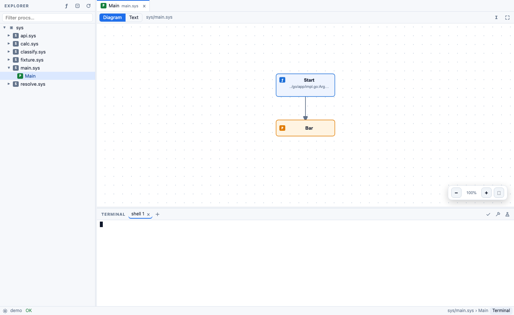

# The IDE

`ide`, built alongside vcc in `rs/`, serves an IDE on the working directory:

```
cd examples/demo
ide                          # http://127.0.0.1:8080
ide --addr 127.0.0.1:9000
```



- **Explorer** (left): every `.sys` file under the directory, grouped by
  project, with the procs in each (the `ƒ` button lists funcs, types and
  interfaces too). Click a proc to open its diagram; click a project for its
  overview: its manifest, entry points, files and counts. An HTTP server's
  entry shows the command that starts it (`api [--addr host:port]`, the
  executable named after its Rust bin or Go package), and with a `cli` the
  proc a command runs instead (`grove <command> [args…]` → `GroveCli`).
- **Tabs** (centre): a proc each, as a **diagram** or as **text**, compiled
  as you type. A file is compiled together with the rest of its project.
  Diagnostics show in place, with the same messages as `vcc check`.
  Use **Split right** or **Split down** to open the active tab in another
  group. Splitting a proc opens its other view, so you can edit text beside
  the diagram. All open views of a file share its draft.
  Drag a tab onto another group's tab strip to move it, or drop it at an
  edge of an editor to create a group there. Drag the divider to resize
  groups. Reloading restores the group layout, sizes, and tabs.
  **Pop out tab** opens a separate window with the same draft. Use **Dock
  in IDE** or close the window to return the tab. Reloading the main IDE
  restores popped-out tabs in their original groups.
- **Diagrams** are drawn from the graph: funcs, procs (orange), interface
  funcs (purple), switches with their arm labels, loops, for each regions
  and spawns. A proc's diagram starts with its signature node at the top,
  a pill with the proc's name and parameters; click it for the proc's
  signature and source. Click a proc in a diagram to expand it in place:
  its panel's header stands for its signature, so loops back to the
  signature end under the header. Click any node for its details,
  including its implementations' source, read out of their files. Edit in
  the text tab; the diagram follows.
- **Signatures and doc comments** show on the nodes: under a func's,
  proc's or instance's name its signature, then its doc's first line, each
  cut to the node's width with a ▸ when there's more; click one to open it
  (▾ closes it). An open doc reads as paragraphs: a line break inside a
  paragraph is a space, a blank line starts a new paragraph, and a line
  starting with `-` or `*` starts a list item. A func's implementations
  show in its details, not on its node. The details panel shows a func's, proc's or type's doc in
  full, under its signature (the signature node's is its proc's), and the
  explorer's tooltips and the project overview's entry points show them
  too.
- **Terminal** (bottom): shells in the project, and Check, Build and Test
  buttons that run vcc on the active file's project. Terminals are offered
  only when the IDE listens on a loopback address.

Settings (the gear in the status bar) pick the theme, where the terminal and
details panels sit, and the compiler the buttons run: `vcc` from the `PATH`,
or a path to one.

| Shortcut | |
|---|---|
| Ctrl/⌘ + S | Save the file |
| Ctrl + \` | Show or hide the terminal |
| Click a proc | Expand it in place (in a diagram); open its diagram (in the explorer) |
| Shift + click | Select a proc in a diagram without expanding it |
| Ctrl/⌘ + click | Open a proc in a new tab |
| Middle-click a tab | Close it |

Other pages:

- `/viewer?path=sys/calc.sys&proc=Calc`: one proc's diagram and text, as in
  a tab.
- `/workbench`: an editor beside the generated Go and Rust, for trying
  things out.
- `/viz`: the diagram on its own, for a `.sys` file given by path.

Writes and terminals need the per-run token the pages are served with, so
other sites can't drive them. On a loopback address the IDE also requires a
loopback `Host`, against DNS rebinding.

## Editors

An editor's git gutter can compare against the worktree's base,
`refs/worktree/base` (see [Comparing revisions](projects.md#the-base)),
instead of the index. Set the base first (`vcc base <rev>`; grove sets it
for each idea): while the ref is unset there's nothing to compare against.

**vim-gitgutter**, in your vimrc (or `b:gitgutter_diff_base` for one
buffer):

```vim
let g:gitgutter_diff_base = 'refs/worktree/base'
```

gitgutter names the base in the `git show` it runs when it updates a
buffer's signs. After moving the base, `:GitGutterAll` updates every
buffer at once.

**gitsigns.nvim**, once it's set up:

```lua
require('gitsigns').change_base('refs/worktree/base', true)
```

`true` applies it to every buffer, including ones opened later. Run it again
after moving the base, so every buffer is compared against the new commit,
for instance from a command:

```lua
vim.api.nvim_create_user_command('VccBase', function(o)
  if o.args ~= '' then vim.fn.system({ 'vcc', 'base', o.args }) end
  require('gitsigns').change_base('refs/worktree/base', true)
end, { nargs = '?' })
```

For clients that can't be pointed at a ref, there's `vcc review`
([Reviewing in other git clients](projects.md#reviewing-in-other-git-clients)).
