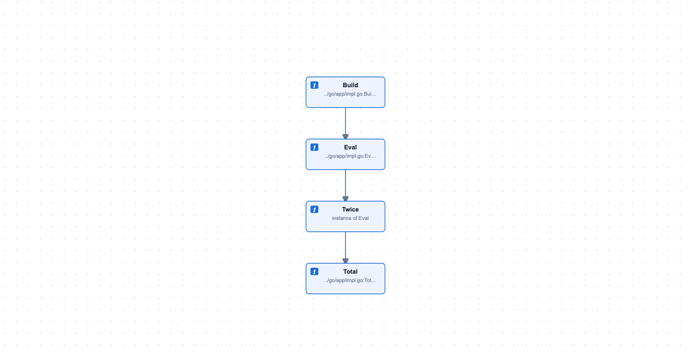
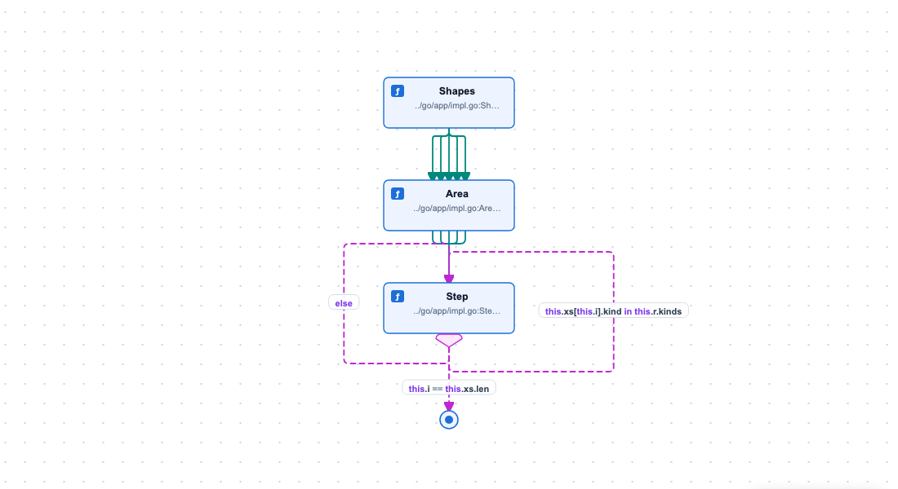
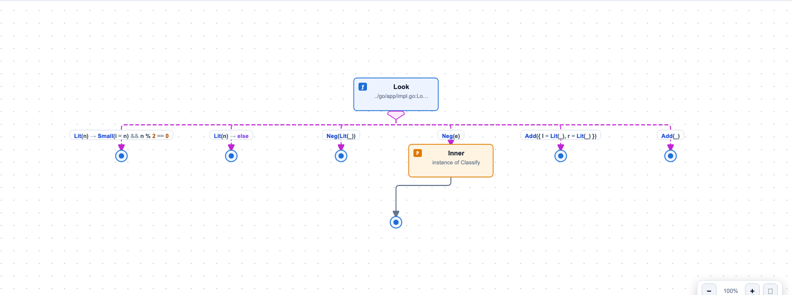

# The language

A vandorf program is a set of `.sys` files sharing one namespace: types,
interfaces, funcs and procs declared in one file can be used from any other,
in any order. Comments run from `//` to the end of the line; the ones
directly above a declaration are its [doc comment](#doc-comments).

```
type Expr = enum { Lit(int), Neg(Expr), Add({ l: Expr, r: Expr }) };

proc Calc(base: int): int {
	func Build(base: int): Expr = "../go/app/impl.go:Build", "../rs/src/impls.rs:build";
	func Eval(e: Expr, scale: int): int = "../go/app/impl.go:Eval", "../rs/src/impls.rs:eval";
	func Total(xs: []int): int = "../go/app/impl.go:Total", "../rs/src/impls.rs:total";

	Calc -> Build(base = this.base);
	Build -> Eval(e = Add({ l = Neg(this), r = Lit(10) }), scale = 1);
	Eval -> Eval(e = Build, scale = 2) as Twice;
	Twice -> Total(xs = [Eval, Twice, 100]);
}
```



## Funcs

A func is a node with typed parameters and a result, implemented outside
vandorf:

```
func Area(s: Shape): Measured = "../go/app/impl.go:Area", "../rs/src/impls.rs:area";
func Log(line: string) = "../go/app/impl.go:Log", "../rs/src/impls.rs:log";
func Branch1(i: int): string;
```

- Without a result type, a func returns `void`.
- After `=` come its implementations, one per backend, as `"file:function"`:
  each backend uses the one with its extension (`.go`, `.rs`). Paths are
  relative to the `.sys` file. See [Implementations](projects.md#implementations).
- A func without an implementation for a backend calls a generated stub that
  fails, so a program can be drawn and checked before it's written.

Funcs are declared inside a proc (used by that proc) or at the top level
(used by any).

## Interfaces

An interface groups funcs that do I/O or keep state, typically implemented
outside the generated package:

```
interface Foo {
	func Call(s: string): int = "../go/effects/foo.go:Call", "../rs/src/effects.rs:call";
}
```

A proc calls one as `Foo.Call(s = this)`, and later edges name its node
`Foo.Call`.

## Procs

A proc is a graph of nodes. It's declared like a func, except that a body
takes the place of `= "file:function"`:

```
proc Main(a: int, b: string): string {
	func Start(a: int, b: string): { a: int, b: string } = "../go/app/impl.go:Args", "../rs/src/impls.rs:args";

	Main -> Start(a = this.a, b = this.b);
	Start -> Bar(a = this.a, b = this.b);
}
```

- The header is the proc's **signature**: its parameters and its result
  type. Callers call it like a func: `Main(a = 1, b = "x")`.
- The proc's own name is its **signature node**, the first node to run.
  Its output is its parameters, by name: `this.a` on its edge, `Main.b`
  anywhere after. The body must start from it: its first edge leaves
  `Main` (`Main -> ..`, `Main switch { .. }`, `Main for each ..`), or it's
  an error at that edge.
- The body declares funcs (and nested procs), then **edges**.
- A proc ends at a node with no outgoing edge, whose result is the proc's,
  so every such node returns the proc's type; or with `id(value)`, below.
- Procs are nodes too: an edge can call another proc, or the same one.

### Loops and recursion

Inside a proc, its own name is the signature node, so:

- A bare `-> Main(..)` is a back edge to the signature node: a **loop**,
  running the body again with new parameters.
- `-> Main(..) as Inner` is a **recursive call**: a separate instance of
  the proc, which returns to `Inner` (the usual rule for aliases, below).

```
proc Count(n: int, acc: int): int {
	Count switch {
		(this.n == 0) -> id(this.acc),
		else -> Count(n = this.n - 1, acc = this.acc + this.n)
	};
}

proc Fib(n: int): int {
	func Add(a: int, b: int): int;
	Fib switch {
		(this.n < 2) -> id(this.n),
		else -> Fib(n = this.n - 1) as A
	};
	A -> Fib(n = Fib.n - 2) as B;
	B -> Add(a = A, b = this);
}
```

## Edges

An edge leaves a node once it has run, and says what runs next:

```
A -> B(x = this, y = Start.l);
```

- Arguments are named, and every parameter is given.
- `this` is the output of the edge's source (`A`); other nodes' outputs are
  read by name (`Start`, `Start.l`).
- An edge may only read outputs of nodes that ran on every path to it (the
  node dominates the edge's source in the proc's graph; inside a `for each`,
  an outer node must have run before the `for each` opened). Anything else is
  a compile error, so generated code never reads a node that hasn't run.
- Each node has at most one outgoing edge: a plain `->`, a `switch`, a
  `for each`, a `collect each` or a `spawn`.

### Aliases

`-> B(..) as B2` calls a separate instance of `B` named `B2`, with its own
output and outgoing edge, so one func can be used at several points in a
proc. Later edges call the same instance with `-> B2(..)`, or with `as B2`
again.

### id

`id(value)` ends a proc with a value, checked against the proc's result
type: `A switch { (this > 0) -> id({ n = this, tags = [] }), .. }`. It's the
identity func, built in, so procs don't need an identity func per result
type. Each `id(..)` is its own node, drawn as a dot.

`id(value) as N` is a node N whose output is the value. Unlike a bare
`id(..)` it can have an edge of its own, so it doesn't end the proc: it
binds a value to a name, to switch on or read later, or merges several
branches into one node. Every `id(..) as N` in a proc is the same node;
its type is that of the values passed to it, which must agree.

```
Merge switch {
	{ e = A(x) } -> id(x) as D,
	{ e = B(x) } -> id(x + 1) as D
};
D -> G(x = this);
```

That makes loop heads in the middle of a proc, too:

```
proc Sum(xs: []int): int {
	Sum -> id({ i = 0, acc = 0 }) as L;
	L switch {
		(L.i == Sum.xs.len) -> id(L.acc),
		else -> id({ i = L.i + 1, acc = L.acc + Sum.xs[L.i] }) as L
	};
}
```

The type comes from the first value that has one of its own, so a struct
literal there (`{ i = 0, acc = 0 }`) has its fields' types; an empty `[]`
or `[:]` has none, so write the first value with an element, or pass it
through a typed node.

### For each

```
Start for each (Start.l) -> Process(i = this, l = Start.l);
Process collect each (Process) -> Collect(l = this);
```

`for each (array)` runs what follows once per element, with `this` the
element. The region it opens ends at a `collect each (Node)`, whose `this`
is the array of `Node`'s outputs, one per element, in order. Inside the
region, nodes outside it are visible only if they ran before it opened.



### Spawns

Spawns run nodes concurrently:

```
A -> spawn { Fetch(url = this.a), Fetch(url = this.b) as F2, detach Log(line = "go") } join Merge(x = this.Fetch, y = this.F2);
```

- Each branch is one node called with A's output as `this`.
- The join runs once the joined branches have finished, with `this` their
  outputs by node name (void ones left out). If one fails, the proc fails.
- A `detach`ed branch runs on its own: nothing waits for it, its output goes
  nowhere, and a failure is only logged, so a strip of detached branches is
  fire and forget (the join runs at once).
- A branch runs only in its spawn: it has no edge of its own, and its output
  is the join's alone.

Rust runs branches on threads (joined ones scoped to the step), Go on
goroutines (detached ones outlive the request's cancellation). The diagram
draws a spawn as a row of dotted cells, detached ones faded.

## Switches

```
Look switch {
	Lit(n) -> switch {
		(Small(i = n) && n % 2 == 0) -> Say(s = "small even"),
		else -> Say(s = "literal")
	},
	Neg(Lit(_)) -> Say(s = "negated literal"),
	Neg(e) -> Classify(e = e) as Inner,
	Add({ l = Lit(_), r = Lit(_) }) -> Say(s = "sum of literals"),
	Add(_) -> Say(s = "something else")
};
```

A switch's arms are tried in order, and the first that matches is taken.
They're either all patterns or all conditions; `else` may come last.

- **Patterns** match structure, in the shape of the literal that builds
  the value: `Tag(p)` (or `Tag()` for a variant without payload),
  `{ f = p, g = p }` listing every field, `_`, a binding `x`, and `p | q`
  (which can't bind yet). A pattern switch needs an `else` unless its arms
  cover every value; missing cases are reported as patterns
  (`doesn't cover Add({ l = Neg(_), r = _ })`), and arms that can't match
  are errors.
- **Conditions** are `(expr)` arms and need an `else`. A pattern arm can lead
  to a nested `switch { (cond) -> .., else -> .. }` that sees its bindings;
  nothing falls through to the outer switch.

The diagram draws one edge per call a switch can end in, labelled with the
arm heads on the way (`Lit(n) → else`).



## Types

| Type | Written | Go | Rust |
|---|---|---|---|
| primitives | `int`, `float`, `bool`, `string`, `void` | `int`, `float64`, `bool`, `string` | `i64`, `f64`, `bool`, `Str` (`Arc<str>`) |
| arrays | `[]T` | `[]T` | `List<T>` (a shared `Vec`) |
| maps | `map[K]V`, `K` `int` or `string` | `map[K]V` | `Map<K, V>` (a shared `BTreeMap`) |
| structs | `{ a: int, b: string }` | a named struct | a named struct |
| enums | `enum { A, B(T) }` | a struct with a `Tag` and a field per variant | a named enum |

Every struct or enum shape gets one generated name, taken from where it
first appears or from its typedef; equal shapes share it. Field, parameter
and argument names may be keywords (`{ type: string }`).

### Typedefs

`type Name = <type>;` at the top level, in any order, and possibly recursive
(a recursive one must be a struct or enum). A typedef is a name for its
structure, so it and its definition written out are interchangeable.
Codegen names the shape after the typedef; typedefs of primitives, arrays,
or already-named shapes become aliases (`type Ids = []int`). Fields that
would make a type contain itself are `*T` in Go and `Box<T>` in Rust.

### Generic typedefs

`type R<T> = { x: T, pos: int };`, used with type arguments wherever a type
goes: `func F(): R<[]Tok>`.

- Each distinct use is its own typedef, the body with the arguments
  substituted, so `R<int>` and `{ x: int, pos: int }` are the same type.
- Codegen names instances after their arguments (`R<[]Tok>` → `RTokList`,
  `Map<string, int>` → `MapStringInt`), in Go and Rust alike.
- Arguments are typedefs, primitives (not void), arrays or maps; a struct or
  enum argument needs a typedef.
- A recursive generic may only use itself with arguments that don't grow
  (`List<T>` inside `List<T>`).
- Write `> =`, not `>=`, before an `=`.
- Funcs and procs aren't generic.

## Values and expressions

Arguments, conditions and `id(..)` take expressions:

- **Literals**: `3`, `-1.5`, `"s"`, `true`, `[a, b]`, `{ x = .., y = .. }`
  (every field), `Tag(value)` and `Tag()` for a variant without payload.
  They're checked against the parameter's type (an int literal also passes
  as a float) and can nest references to node outputs.
- **Paths**: a node's output, `this`, or a binding, then `.field`,
  `[index]` or `[key]`.
- **Operators**: `|| && ! == != < <= > >= + - * / %` and `in`. Operands of
  a binary operator have the same primitive type (an int literal also
  passes as a float); `+` concatenates strings. `&&` and `||`
  short-circuit, calls included.
- **Calls** of funcs, `F(param = value)`, run the func's implementation
  directly: the call isn't a node.
- **Struct updates**: `{ ..base, f = v }` is a struct like `base` with
  field `f` set: `Step(s = { ..this, i = this.i + 1 })`. Every field of the
  expected type is given or read from `base` (it may add fields `base`
  doesn't have, but not drop any); with no expected type, the update has
  `base`'s type. `base` must be a path (a node, `this`, a binding, or a
  field of one), so each field read can be moved separately.

### Maps and arrays

```
type Scope = map[string]{ slot: int, kind: string };
...
Declare -> Adjust(scope = this.scope + ["len": { slot = this.scope.len, kind = "builtin" }] - ["tmp"], ..);
Adjust switch {
	(this.query in this.scope) -> Found(slot = this.scope[this.query].slot, ..),
	else -> Missing(known = this.scope.keys, ..)
};
```

- Maps are values: passing one on never lets anyone else change it.
- Literals `["a": 1, "b": 2]` and `[:]`, where a map type is expected.
- `m[k]` looks a key up and `xs[i]` indexes an array; both fail the proc if
  it isn't there, so check first with `k in m` (or `.len`).
- `m + n` is a new map with both (`n` wins); `m - keys` one without `keys`
  (an array, e.g. `["tmp"]`).
- `xs + ys` is a new array with both (`acc + [x]` to append).
- `.len` of maps, arrays and strings; `.keys` and `.values` of maps, in key
  order, so `for each (this.m.keys)` visits keys in the same order in both
  backends. A `for each` takes any array expression.
- Implementations must not change a map they're given (Go maps are
  references).

## Doc comments

The comment lines directly above a declaration are its description:

```
// The area of each shape, summed, and how many there are of each kind.
proc Measure(shapes: []Shape): Report {
	// The area of one shape.
	func Area(s: Shape): Measured = "../go/app/impl.go:Area", "../rs/src/impls.rs:area";
	..
}
```

- Typedefs, interfaces, interface funcs and funcs and procs, top-level or
  nested, take one. An edge's comment is no one's.
- Every `//` line directly above the declaration counts, each without its
  `//` and one space after it. A blank line, or code, ends it: a comment
  with a blank line after it, or at the end of a code line, isn't a doc.
- The diagram shows a node's doc under its name, and the details panel
  shows it in full; generated code carries it as a doc comment on the
  proc's `run_<proc>` / `Run<Proc>` and on types named after a typedef.
- A func's implementations carry the same doc, apart from the comment
  markers: `vcc build` checks it (see [Implementations](projects.md#implementations)).

## Keywords

`interface func proc type enum map switch for each collect as else in id
true false`, and `spawn`, `join` and `detach` after `->`.
